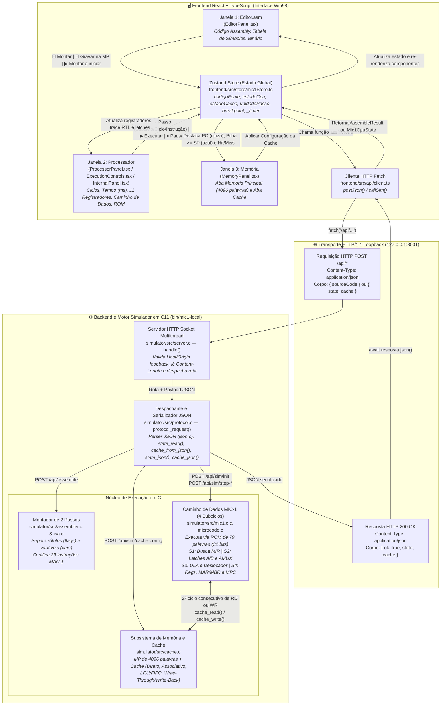
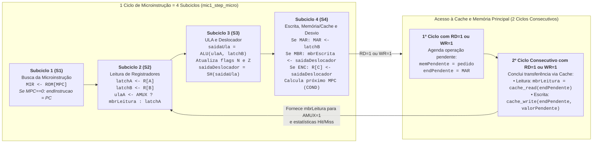

# Fluxo de Execução de um Programa no MIC-1.sim

Este documento descreve o fluxo ponta a ponta de execução de um programa Assembly MAC-1 no **MIC-1.sim**, cobrindo desde a interação do usuário na interface React/TypeScript (estilo Windows 98), o gerenciamento de estado no Zustand, o envio de requisições HTTP/JSON, até o processamento no servidor e motor de simulação em C11 (`bin/mic1-local`).

> **Dica para gravação do vídeo:** Abra o arquivo [`docs/fluxo-execucao.html`](./fluxo-execucao.html) diretamente no navegador para usar a apresentação visual interativa (com avanço passo a passo pelas setas do teclado `←` / `→`).

---

## 1. Visão Geral da Arquitetura (Stateless HTTP/JSON)

O simulador é dividido em duas camadas desacopladas que se comunicam via **HTTP/1.1 local (`127.0.0.1:3001`)**:

1. **Frontend Web (`frontend/src/` → compilado em `web/`)**:
   - Interface construída em **React 19 + TypeScript + Tailwind CSS** distribuída em 3 janelas (`1 - Editor.asm`, `2 - Processador`, `3 - Memória`).
   - O estado da sessão (`codigoFonte`, `resultadoMontagem`, `estadoCpu`, `estadoCache`, `_timer` do clock e `breakpoint`) fica centralizado na store **Zustand** (`frontend/src/store/mic1Store.ts`).
   - O frontend **não executa instruções da CPU**; toda operação de montagem ou avanço de ciclo é solicitada ao motor em C via `fetch()` (`frontend/src/api/client.ts`).
2. **Backend e Motor de Simulação em C11 (`simulator/src/` → `bin/mic1-local`)**:
   - Servidor HTTP socket multithread (`simulator/src/server.c`) que entrega os arquivos estáticos da pasta `web/` (`GET`) e responde à API REST (`POST /api/*` e `GET /api/*`).
   - Protocolo **100% Stateless** (`simulator/src/protocol.c`): a cada passo de execução, o servidor recebe o estado completo da CPU e da Cache em JSON (`state_read` + `cache_from_json`), avança o motor em C e devolve o novo estado serializado (`state_json` + `cache_json`).

---

## 2. Diagrama de Arquitetura Ponta a Ponta



---

## 3. Diagrama de Sequência: Ciclo de Vida da Execução de um Programa

O diagrama abaixo detalha as **3 etapas fundamentais** pelas quais um programa passa desde a escrita do código Assembly até a execução dos ciclos de clock:

```mermaid
sequenceDiagram
    autonumber
    actor U as Usuário
    participant UI as Interface React<br/>(3 Janelas Win98)
    participant Store as Zustand Store<br/>(mic1Store.ts)
    participant API as Cliente HTTP<br/>(api/client.ts)
    participant Server as Servidor HTTP C<br/>(server.c / protocol.c)
    participant Engine as Motor Simulador C<br/>(assembler.c / mic1.c / cache.c)

    rect rgb(232, 244, 253)
    Note over U,Engine: ETAPA 1 — Montagem do Programa Assembly (POST /api/assemble)
    U->>UI: Digita ou escolhe exemplo Assembly e clica em "🔨 Montar"
    UI->>Store: apenasMontar() (ou montarEIniciar())
    Store->>API: assembleProgram({ sourceCode })
    API->>Server: POST /api/assemble { "sourceCode": "LODD var1..." }
    Server->>Engine: mic1_assemble(codigoFonte, &resultado)
    Note right of Engine: Passo 1: Registra rótulos (flags:) e variáveis implícitas (vars)<br/>Passo 2: Codifica as 23 instruções MAC-1 em palavras de 16 bits
    Engine-->>Server: Mic1AssembleResult (sucesso, palavras[], tabela de símbolos)
    Server-->>API: HTTP 200 JSON { success: true, program: [...], labelTable: [...] }
    API-->>Store: Salva resultadoMontagem
    Store-->>UI: Janela 1 exibe binário compilado e tabela de símbolos (flags / vars)
    end

    rect rgb(234, 250, 238)
    Note over U,Engine: ETAPA 2 — Carga na Memória Principal e Inicialização (POST /api/sim/init)
    U->>UI: Clica em "💾 Gravar código na MP" (ou automático via "▶ Montar e iniciar")
    UI->>Store: gravarNaMemoria() / montarEIniciar()
    Store->>API: simInit(program.map(w => w.word))
    API->>Server: POST /api/sim/init { "program": [3089, 2561, ...] }
    Server->>Engine: mic1_init(c, palavras, tam) + cache_init_default(&c->cache)
    Note right of Engine: Zera registradores, define PC = 0, SP = 4096, proxSubciclo = 1,<br/>copia o programa para memoria[0..tam-1] e inicializa linhas da Cache
    Engine-->>Server: Mic1State + Mic1Cache iniciais
    Server-->>API: HTTP 200 JSON { ok: true, state: {...}, cache: {...} }
    API-->>Store: Atualiza estadoCpu, estadoCache e cpuIniciada = true
    Store-->>UI: Janela 2 habilita controles da CPU; Janela 3 destaca instruções na MP
    end

    rect rgb(254, 246, 232)
    Note over U,Engine: ETAPA 3 — Execução de Passos ou Clock Contínuo (POST /api/sim/step-*)
    U->>UI: Clica em "→ Passo" (ou "▶ Executar", que dispara setInterval a cada pausaMs)
    UI->>Store: passoSelecionado() -> _passo(unidadePasso)
    alt Modo = Subciclo ("subcycle")
        Store->>API: simStepSubcycle(estadoCpu) -> POST /api/sim/step-subcycle
    else Modo = Ciclo de Clock ("cycle" - padrão)
        Store->>API: simStepMicro(estadoCpu) -> POST /api/sim/step-micro
    else Modo = Instrução Macro ("instruction")
        Store->>API: simStepMacro(estadoCpu) -> POST /api/sim/step-macro
    end
    API->>Server: POST /api/sim/step-* { "state": estadoCpu, "cache": estadoCache }
    Server->>Engine: state_read(c, req.state) + cache_from_json(&c->cache, req.cache)
    Engine->>Engine: Executa mic1_step_subcycle() / mic1_step_micro() / mic1_step_macro()
    Note right of Engine: S1: MIR <- ROM[MPC]<br/>S2: latchA <- R[A]; latchB <- R[B]; ulaA <- AMUX ? mbrLeitura : latchA<br/>S3: ULA (A+B, A&B, A, ~A), flags N/Z e Deslocador (<<1, >>1 aritmético)<br/>S4: Escreve R[C], MAR, mbrEscrita, acessa Cache/MP (2º ciclo RD/WR) e calcula MPC
    Engine-->>Server: Mic1State + Mic1Cache atualizados (registradores, trace RTL, hit/miss)
    Server-->>API: HTTP 200 JSON { ok: true, state: {...}, cache: {...} }
    API-->>Store: Atualiza estadoCpu, estadoCache e enderecosGravados
    Store->>Store: Verifica parada (halted) ou Breakpoint de disparo único (PC == breakpoint)
    Store-->>UI: Re-renderiza Janela 2 (Registradores/Caminho de Dados) e Janela 3 (MP e Cache)
    end
```

---

## 4. Fluxo Interno do Motor C: Os 4 Subciclos do MIC-1 (`mic1.c`)

Dentro do backend C, nenhuma macroinstrução MAC-1 (`LODD`, `ADDD`, `PUSH`, `CALL`, etc.) é executada diretamente por `switch/case` de alto nível. **Toda execução passa pelos 4 subciclos do caminho de dados microprogramado**, guiados pela memória de controle ROM de 79 palavras de 32 bits (`simulator/src/microcode.c`):



---

## 5. Tabela de Mapeamento Ponta a Ponta (UI → HTTP → C)

| Ação do Usuário na UI | Componente React | Função no Zustand (`mic1Store.ts`) | Cliente HTTP (`api/client.ts`) | Rota HTTP (`server.c` → `protocol.c`) | Função Executada no Motor C |
| :--- | :--- | :--- | :--- | :--- | :--- |
| Clicar em **`🔨 Montar`** | `EditorPanel.tsx` | `apenasMontar()` | `assembleProgram({ sourceCode })` | `POST /api/assemble` | `mic1_assemble()` (`assembler.c`) |
| Clicar em **`💾 Gravar código na MP`** | `EditorPanel.tsx` | `gravarNaMemoria()` | `simInit(words)` (ou atualiza array `memory` local) | `POST /api/sim/init` | `mic1_init()` + `cache_init_default()` (`mic1.c` / `cache.c`) |
| Clicar em **`▶ Montar e iniciar`** | `EditorPanel.tsx` | `montarEIniciar()` | `assembleProgram()` seguido de `simInit()` | `POST /api/assemble` → `POST /api/sim/init` | `mic1_assemble()` → `mic1_init()` |
| Clicar em **`→ Passo (Subciclo)`** | `ExecutionControls.tsx` | `passoSelecionado()` → `_passo("subcycle")` | `simStepSubcycle(estadoCpu)` | `POST /api/sim/step-subcycle` | `state_read()` → `mic1_step_subcycle()` (`mic1.c`) |
| Clicar em **`→ Passo (Ciclo)`** | `ExecutionControls.tsx` | `passoSelecionado()` → `_passo("cycle")` | `simStepMicro(estadoCpu)` | `POST /api/sim/step-micro` | `state_read()` → `mic1_step_micro()` (4 subciclos) |
| Clicar em **`→ Passo (Instrução)`** | `ExecutionControls.tsx` | `passoSelecionado()` → `_passo("instruction")` | `simStepMacro(estadoCpu)` | `POST /api/sim/step-macro` | `state_read()` → `mic1_step_macro()` (até `MPC==0, S1`) |
| Clicar em **`▶ Executar`** | `ExecutionControls.tsx` | `iniciarExecucao()` (`setInterval` a cada `pausaMs`) | Dispara `passoSelecionado()` periodicamente | `POST /api/sim/step-*` repetidamente | Avança na unidade escolhida até pausar ou atingir `breakpoint` |
| Clicar em **`Aplicar Configuração`** (Aba Cache) | `MemoryPanel.tsx` | `configurarCache(config)` | `fetch("/api/sim/cache-config")` | `POST /api/sim/cache-config` | `cache_configure()` (faz flush de linhas sujas e recalcula conjuntos/vias) |

---

## 6. Roteiro Rápido para Explicar no Vídeo (60 a 90 segundos)

1. **Arquitetura Desacoplada (Frontend vs. Backend C)**:
   - *"A interface gráfica foi construída em React e TypeScript com visual inspirado no Windows 98, mas ela atua apenas como painel de controle e visualização. Todo o trabalho pesado de montagem e simulação do hardware roda em um binário nativo escrito em C11 (`mic1-local`)."*
2. **Comunicação via Requisições HTTP Stateless**:
   - *"A comunicação entre a interface e o motor em C acontece via requisições HTTP JSON locais (`127.0.0.1:3001`). O protocolo é stateless: a store Zustand da interface guarda o estado atual da CPU e da Cache e o envia em cada requisição."*
3. **Etapa 1 e 2 — Montagem e Carga na Memória Principal**:
   - *"Quando clicamos em **Montar e iniciar**, o frontend faz primeiro um `POST /api/assemble` enviando o código-fonte Assembly. O montador de dois passos em C (`assembler.c`) separa rótulos de desvio (`flags`) e variáveis implícitas (`vars`), converte as instruções para palavras binárias de 16 bits da ISA MAC-1 e devolve para a interface. Em seguida, o frontend envia essas palavras em um `POST /api/sim/init`, que carrega a Memória Principal de 4096 palavras, posiciona `PC = 0` e `SP = 4096`, e inicializa a Cache."*
4. **Etapa 3 — Passo de Execução e os 4 Subciclos**:
   - *"Quando clicamos em **Passo** (ou em **Executar** com o timer contínuo), o frontend envia um `POST /api/sim/step-micro` (ou `step-subcycle` / `step-macro`) com o estado atual. O servidor C (`server.c` e `protocol.c`) reconstrói a struct `Mic1State`, executa os 4 subciclos reais do caminho de dados do MIC-1 usando a memória de controle ROM de 79 palavras (`S1: busca MIR`, `S2: barramentos A/B e AMUX`, `S3: ULA e deslocador`, `S4: escrita nos registradores, acesso de 2 ciclos à Cache/MP e cálculo do próximo MPC`) e devolve o novo JSON."*
5. **Atualização Reativa das 3 Janelas**:
   - *"Assim que a resposta HTTP chega, o Zustand atualiza o estado e o React re-renderiza instantaneamente os 11 registradores, os sinais internos do caminho de dados, a pilha destacada em azul na Memória Principal e as taxas de Hit/Miss e linhas da Cache."*
